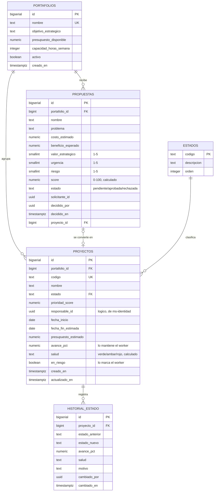

# Modelo de datos — ms-portafolios

**Motor:** PostgreSQL en el RDS compartido
**Database:** `ppm_portafolios`
**Schemas:** `t_acme`, `t_globex`, `t_initech` — uno por tenant

Patrón del enunciado: **Single Database, Multiple Schemas**. Las tres copias del
esquema son idénticas; lo que cambia son los datos. La Lambda hace
`SET search_path TO <schema>` según el `tenant_id` del token, y de ahí en
adelante los queries van sin prefijo: `SELECT * FROM proyectos` ya solo ve las
filas de ese tenant.

## Diagrama entidad-relación



## Las 3 columnas que la API no escribe

`avance_pct`, `salud` y `en_riesgo` **no se actualizan por HTTP**. Las mantiene
el worker de SQS a partir de eventos de otros microservicios:

| Columna | Quién la escribe | A partir de |
|---|---|---|
| `avance_pct` | `worker.manejar` | `tarea.completada` de ms-tareas |
| `en_riesgo` | `worker.manejar` | `presupuesto.excedido` de ms-presupuestos |
| `salud` | `worker._salud` | se deriva de las dos anteriores + el estado |

**Ahí está el valor del EDA:** nadie reporta el avance a mano, y
`ms-portafolios` no conoce a `ms-tareas` ni a `ms-presupuestos`.

## Referencias lógicas, sin FK

`responsable_id`, `solicitante_id`, `decidido_por` y `cambiado_por` son UUIDs de
usuarios que viven en `ms-identidad`. **No hay FK ni validación HTTP**: los
microservicios son autónomos, para que el atraso de uno no bloquee a los demás.
Por la misma razón las bajas de usuario en `ms-identidad` son lógicas: si se
borraran, estas referencias quedarían huérfanas.

## El score de prioridad

```
score = valor_estrategico × 8          (hasta 40)
      + urgencia × 5                   (hasta 25)
      + min(beneficio/costo, 3) × 8.33 (hasta 25)
      − riesgo × 2                     (hasta −10)
```

Topado entre 0 y 100. La fórmula es deliberadamente simple y explicable: el PMO
tiene que poder entender por qué un proyecto quedó arriba. El retorno se topa en
3× para que un caso optimista no domine el ranking.

| Caso | ve | urg | riesgo | costo | beneficio | score |
|---|---|---|---|---|---|---|
| ideal | 5 | 5 | 1 | 100k | 300k | **88.0** |
| promedio | 3 | 3 | 3 | 50k | 100k | **49.7** |
| peor | 1 | 1 | 5 | 100k | 50k | **7.2** |

## Índices

| Índice | Para qué consulta |
|---|---|
| `ix_proyectos_portafolio` | proyectos de un portafolio (la vista de detalle) |
| `ix_proyectos_estado` | el Kanban por estado |
| `ix_proyectos_prioridad` | el ranking del portafolio |
| `ix_propuestas_estado` | la bandeja de admisión, ya ordenada por score |
| `ix_historial_proyecto` | la línea de tiempo de un proyecto |

## Volumen de datos

| Tabla | Por tenant | Total (3 tenants) |
|---|---|---|
| `portafolios` | 20 | 60 |
| `proyectos` | 500 | 1,500 |
| `propuestas` | 300 | 900 |
| `historial_estado` | 9,180 | 27,540 |
| **Total** | **10,000** | **30,000** |

Las tres copias tienen **perfiles distintos** a propósito:

| | t-acme (construcción) | t-globex (consultoría) | t-initech (software) |
|---|---|---|---|
| Presupuesto por proyecto | S/ 200k – 900k | S/ 20k – 150k | S/ 10k – 60k |
| Tareas típicas | 8 – 20 | 20 – 60 | 150 – 500 |
| Portafolios | por zona de obra | por cartera de cliente | por línea de producto |

Si los tres tuvieran la misma forma, el multi-tenancy se vería de cartón en la
demo.

## Cargar los datos

```bash
export DB_HOST=... DB_USER=ppm_portafolios DB_PASSWORD=... DB_NAME=ppm_portafolios
python seed/generar.py --esquema   # crea las tablas en los 3 schemas
python seed/generar.py             # carga los 30,000 registros
python seed/generar.py --contar    # verifica
```
